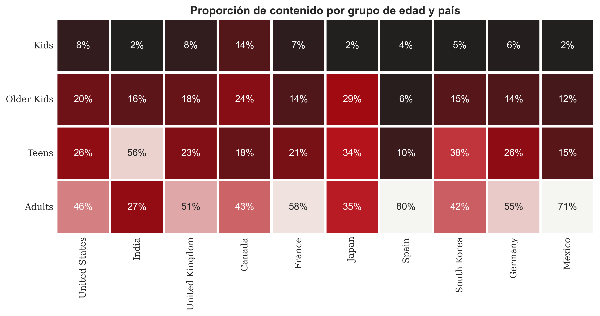
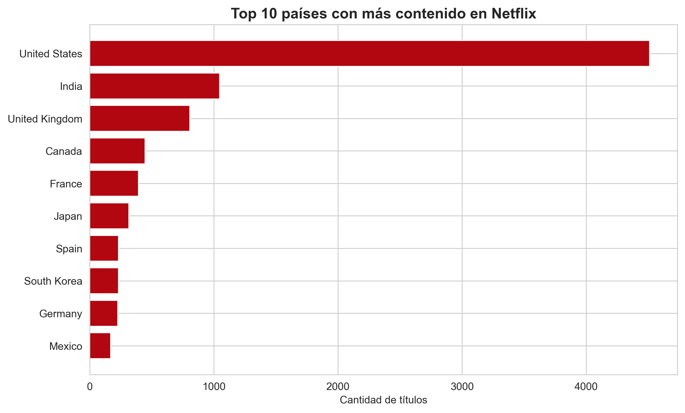
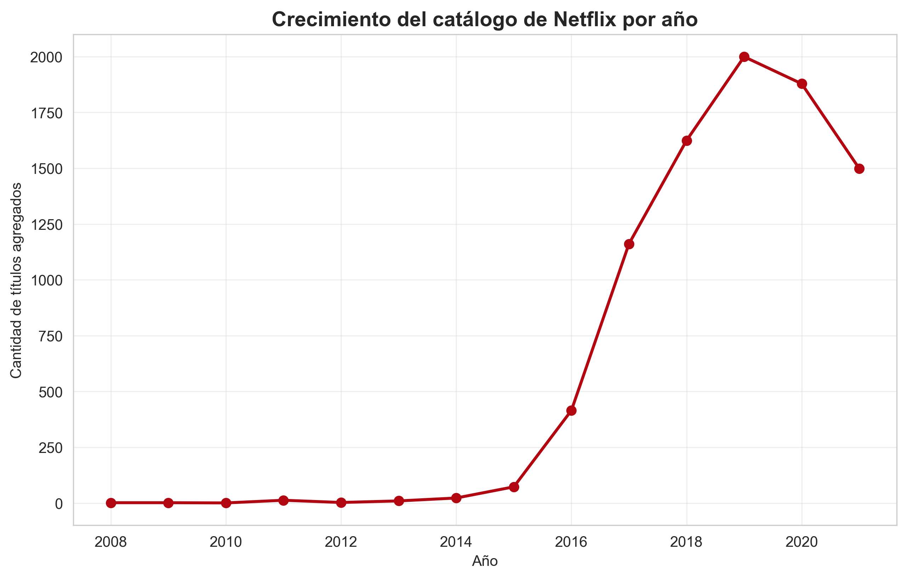
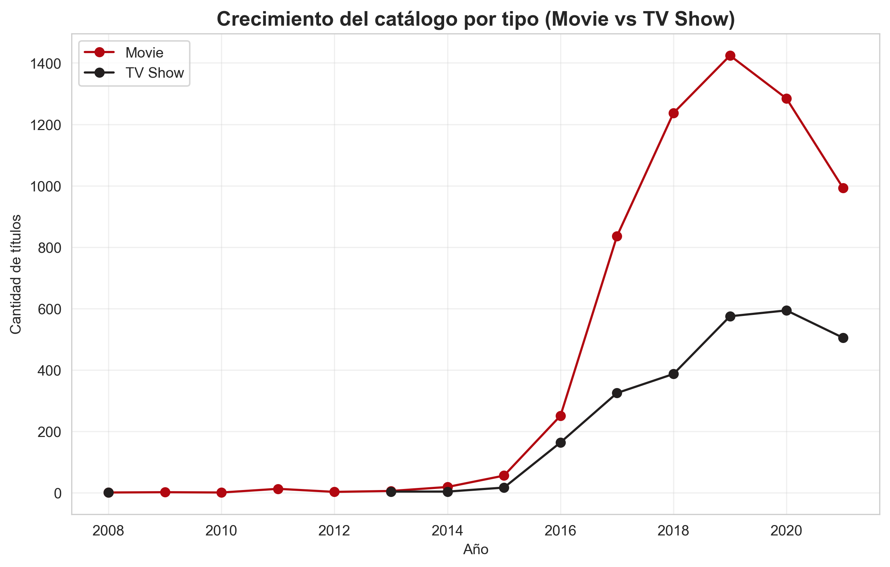
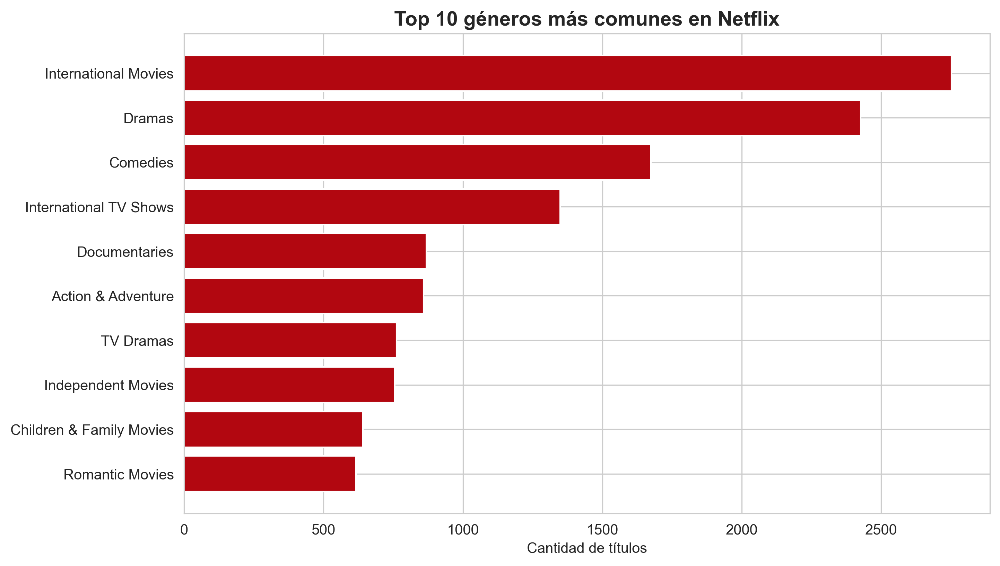
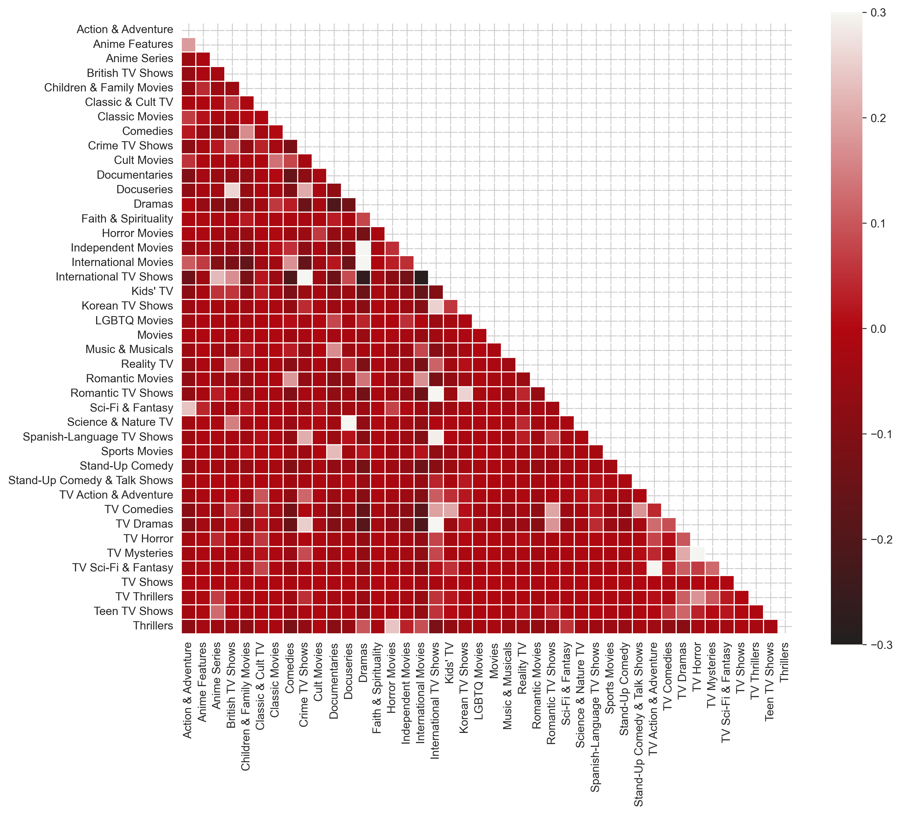
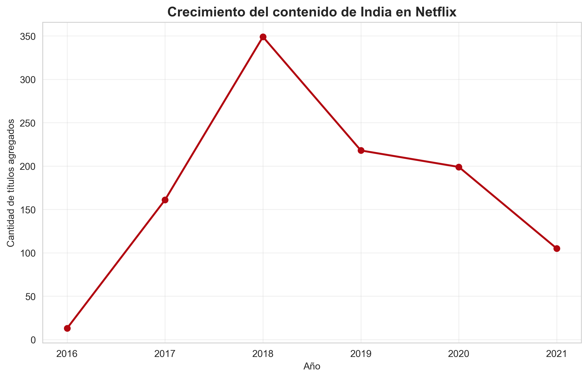
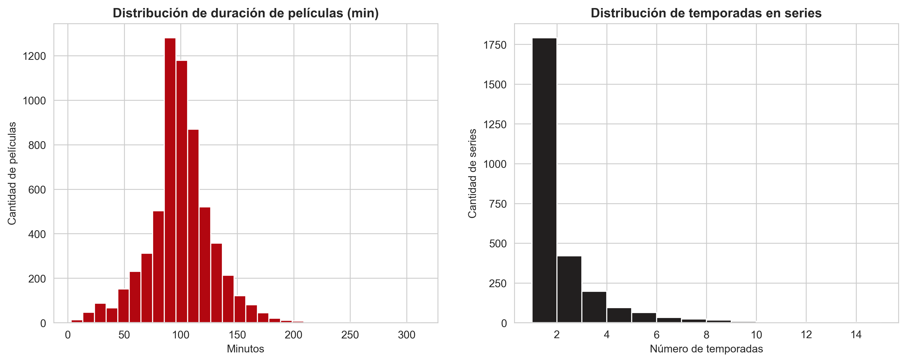
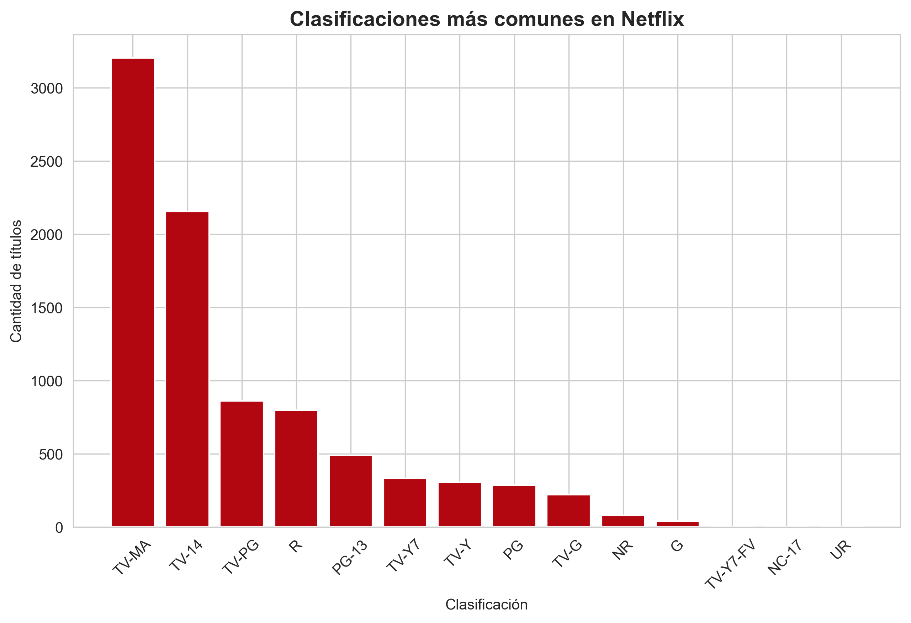

# Netflix Data Analysis

Análisis exploratorio de datos (EDA) del catálogo de Netflix: limpieza, transformación,
visualización e insights sobre contenido, países, géneros y tendencias temporales.


---

## Dataset

**Fuente:** [Netflix Movies and TV Shows](https://www.kaggle.com/datasets/shivamb/netflix-shows) (Kaggle)

| | |
|---|---|
| Registros originales | 8,807 títulos |
| Registros tras limpieza | 8,790 títulos |
| Variables | 12 originales + 4 derivadas |
| Período cubierto | Enero 2008 – Septiembre 2021 |
| Año de estreno | 1925 – 2021 |

Columnas: `show_id`, `type`, `title`, `director`, `cast`, `country`, `date_added`,
`release_year`, `rating`, `duration`, `listed_in`, `description`.

Variables derivadas en la limpieza: `duration_int`, `duration_type`, `year_added`, `month_added`.

---

## Objetivo

Partiendo de un dataset crudo, construir un pipeline reproducible de limpieza y
responder preguntas de negocio sobre la composición y evolución del catálogo:

- ¿Netflix es una plataforma de películas o de series?
- ¿Qué países concentran la producción de contenido?
- ¿Cómo creció el catálogo y cuándo se aceleró?
- ¿Qué géneros predominan y cuáles ganaron terreno?
- ¿A qué audiencia está dirigido el contenido?

---

## Estructura del proyecto

```
netflix-data-analysis/
├── data/
│   ├── raw/                      # Dataset original, nunca se modifica
│   └── processed/                # Dataset limpio + tablas resumen
├── notebooks/
│   └── 01_analisis.ipynb         # EDA y visualizaciones
├── src/
│   └── transformation/
│       └── cleaner.py            # Pipeline de limpieza reproducible
├── outputs/                      # Gráficos exportados (.png)
├── requirements.txt
└── README.md
```

Separar `src/` de `notebooks/` permite que la limpieza sea reproducible y testeable,
mientras el notebook queda dedicado a la exploración.

---

## Proceso de limpieza

| Problema detectado | Tratamiento |
|---|---|
| `director` — 2,634 nulos (30%) | Imputado como `"No Data"` (volumen alto, eliminar sesgaría) |
| `cast` — 825 nulos (9%) | Imputado como `"No Data"` |
| `country` — 831 nulos (9%) | Imputado con la moda |
| `date_added` — 10 nulos | Filas eliminadas (impacto despreciable) |
| `rating` — 4 nulos | Filas eliminadas |
| `duration` — 3 nulos | Filas eliminadas |
| `date_added` como texto | Convertido a `datetime`; derivados año y mes |
| `duration` mezclaba unidades | Separado en valor numérico y unidad (`min` / `Season`) |
| `country` y `listed_in` multivalor | Normalizados y expandidos con `explode()` para conteos reales |

Resultado: **0 nulos, 0 duplicados**, tipos de dato correctos.

---

## Insights principales

### 1. El catálogo es mayoritariamente de películas



**69.7% películas (6,126) frente a 30.3% series (2,664).** Pese a que la conversación
pública asocia Netflix con las series originales, el volumen del catálogo sigue
dominado por el cine.

### 2. Estados Unidos concentra la producción, India es el segundo polo



| País | Títulos |
|---|---|
| Estados Unidos | 4,510 |
| India | 1,046 |
| Reino Unido | 805 |
| Canadá | 445 |
| Francia | 393 |

Estados Unidos produce **4.3 veces más contenido que India**, el siguiente en la lista.
La distribución tiene una cola larga: fuera del top 10 la participación cae drásticamente.

### 3. La expansión del catálogo se concentra entre 2016 y 2019



| Año | Títulos añadidos |
|---|---|
| 2015 | 73 |
| 2016 | 415 |
| 2017 | 1,161 |
| 2018 | 1,624 |
| **2019** | **1,999** (pico) |
| 2020 | 1,878 |
| 2021 | 1,498 |

Entre 2015 y 2016 el volumen se multiplicó por 5.7, y alcanzó su máximo en 2019.

> **Nota metodológica:** la recolección del dataset se corta el **25 de septiembre de 2021**.
> La aparente caída de ese año refleja un período incompleto, no un cambio de estrategia.
> Cualquier conclusión sobre 2021 sería engañosa sin esta salvedad.



### 4. El contenido internacional es el género dominante



| Género | Títulos |
|---|---|
| International Movies | 2,752 |
| Dramas | 2,426 |
| Comedies | 1,674 |
| International TV Shows | 1,349 |
| Documentaries | 869 |

Que *International Movies* encabece la lista por encima de *Dramas* confirma que la
estrategia de expansión global se refleja directamente en la composición del catálogo.



El mapa de correlación muestra qué géneros tienden a coexistir en un mismo título.

### 5. Caso de estudio: la trayectoria de India



India alcanzó su **pico en 2018 con 941 títulos**, tras crecer desde 32 en 2016.
El descenso posterior (603 en 2019, 528 en 2020) es generalizado entre géneros —no
hay una categoría que colapse en particular—, lo que apunta a una desaceleración
del ritmo de incorporación más que a un cambio de enfoque editorial.

### 6. Películas de ~100 minutos, series de una sola temporada



- Duración media de las películas: **99.6 minutos**
- Promedio de temporadas por serie: **1.75**
- **67.2% de las series tienen una única temporada**

La distribución de series está fuertemente sesgada: la mayoría no supera la primera
temporada, un patrón coherente con la política de cancelaciones tempranas de la plataforma.

### 7. El catálogo apunta a una audiencia adulta



| Clasificación | Títulos |
|---|---|
| TV-MA (adultos) | 3,205 |
| TV-14 (+14) | 2,157 |
| TV-PG | 861 |
| R | 799 |

**TV-MA y TV-14 representan el 61% del catálogo.** El contenido infantil
(`TV-Y`, `TV-G`, `G`) es claramente minoritario.

### 8. Palabras recurrentes en los títulos


*Love* encabeza con 171 apariciones, seguida de *Man* (88), *Life* (78), *Christmas* (78)
y *World* (71) — un reflejo de las convenciones de titulación de la industria.

---

## Cómo reproducir el análisis

```bash
# 1. Clonar el repositorio
git clone https://github.com/Kaiser-Alex120/netflix-data-analysis.git
cd netflix-data-analysis

# 2. Crear y activar el entorno virtual
python -m venv venv
venv\Scripts\Activate.ps1        # Windows PowerShell
# source venv/bin/activate       # macOS / Linux

# 3. Instalar dependencias
pip install -r requirements.txt

# 4. Ejecutar el pipeline de limpieza
python src/transformation/cleaner.py

# 5. Abrir el notebook de análisis
jupyter notebook notebooks/01_analisis.ipynb
```

---

## Stack técnico

| Herramienta | Uso |
|---|---|
| **pandas** | Manipulación, limpieza y agregación |
| **numpy** | Operaciones numéricas |
| **matplotlib** / **seaborn** | Visualización |
| **scikit-learn** | `MultiLabelBinarizer` para correlación de géneros |
| **wordcloud** | Nube de palabras de títulos |

---

## Conclusiones

1. Netflix es, en volumen, una **plataforma de cine** antes que de series (70/30).
2. El catálogo creció de forma explosiva entre **2016 y 2019**, con un pico de casi 2,000 títulos anuales.
3. La **internacionalización no es un discurso**: el género más frecuente del catálogo es *International Movies*, e India se consolidó como segundo mercado productor.
4. El perfil del contenido es **adulto** (61% TV-MA + TV-14) y de **formato corto** en series (dos tercios con una sola temporada).
5. Validar la integridad temporal del dataset fue determinante: sin detectar el corte de septiembre de 2021, la lectura de la tendencia habría sido errónea.

### Limitaciones

- El dataset no incluye información financiera (presupuesto, ingresos) ni métricas de consumo (visualizaciones, retención), por lo que no es posible evaluar el rendimiento del contenido.
- La imputación de `country` con la moda introduce un sesgo hacia Estados Unidos en el 9% de los registros afectados.
- Los datos reflejan el catálogo a septiembre de 2021 y no incorporan altas ni bajas posteriores.

---

## Licencia

MIT — ver [LICENSE](LICENSE).

## Autor

**Piero Alex** — [@Kaiser-Alex120](https://github.com/Kaiser-Alex120)
